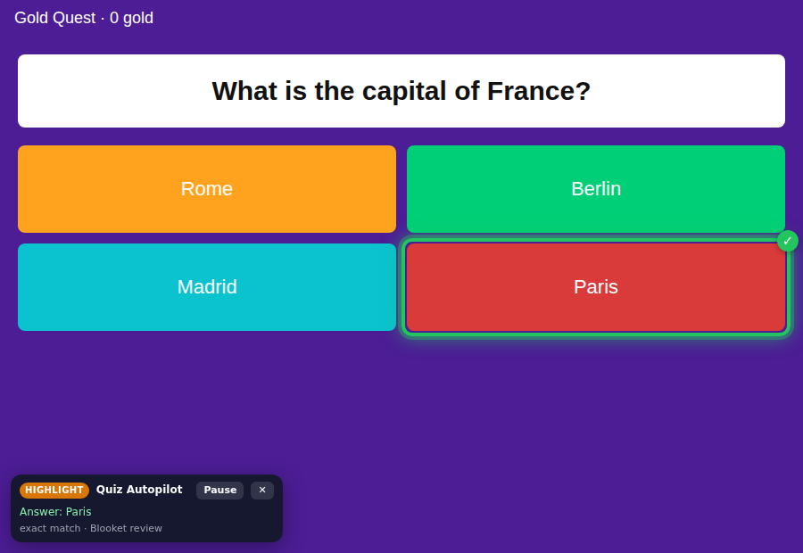
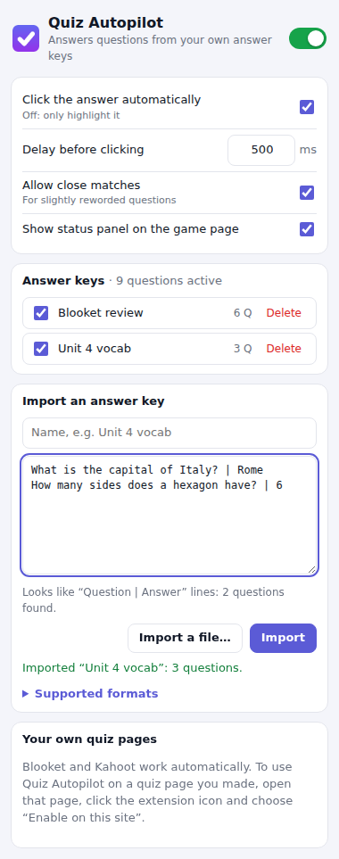

# Quiz Autopilot

A Chrome extension for practice games you made in **Blooket**, **Kahoot** or on your own quiz page. It reads the question and the answer choices on screen, looks the question up in the answer key you imported, highlights the correct choice and clicks it for you.

<p align="center">
  
  
</p>

The answers come only from your answer keys. The extension doesn't read hidden game data and makes no network requests.

## Install

1. Download this repository (green **Code** button → **Download ZIP**, then unzip it) or clone it.
2. Open `chrome://extensions` and switch on **Developer mode** (top right).
3. Click **Load unpacked** and select the `extension` folder.
4. Pin it: click the puzzle-piece icon in the toolbar → pin **Quiz Autopilot**.

Already have the game open? Reload the tab once after installing.

## 1. Import your answer key

Click the Quiz Autopilot icon and paste your key into **Import an answer key**. To pick a file, click **Import a file…** (it opens the full settings page). You can keep several keys and switch each one on or off.

| What you have | What to paste |
| --- | --- |
| The **Blooket** or **Kahoot** spreadsheet you built the game from | Copy the cells *including the header row* from Google Sheets/Excel, or save the sheet as CSV. |
| Any spreadsheet | A header row with a question column, answer columns and a **Correct answer** column that holds the answer number(s) like `2` or `1,3`, a letter, or the answer text. Gimkit and Quizizz templates work too. |
| Just questions and answers | One per line: `What is the capital of France? \| Paris` |
| Q/A notes | `Q: What is 7 × 8?` on one line, `A: 56` on the next |
| JSON | `[{"question": "…", "answer": "…"}]`, questions with `answers` + `correctAnswers`, or choices marked `"correct": true` |

The box tells you what it recognised (“Looks like CSV with a header row: 24 questions found”) before you import.

## 2. Play

- **Blooket:** join your game. When a question appears, the correct answer gets a green outline and is clicked after the delay you set (0.5 s by default).
- **Kahoot:** works when the question and answers are shown on your device. That's the case in student-paced (assigned) games; for live games, turn on *Show questions and answers on players' devices* in the game options. If your device only shows the coloured shapes, Quiz Autopilot falls back to the question number plus the answer's position from your Kahoot spreadsheet. That only works if the question order isn't shuffled.
- **Your own quiz page:** open the page, click the extension icon → **Enable on this site**. Chrome asks for permission once per site. For a page opened from a file on your computer, also switch on *Allow access to file URLs* for Quiz Autopilot in `chrome://extensions`.

A small status panel in the bottom-left corner shows what was matched and what was clicked. **Alt+Shift+A** pauses or resumes on the game page.

### Settings

| Setting | What it does |
| --- | --- |
| On/off switch | Pauses everything (same as Alt+Shift+A). |
| Click the answer automatically | Turn off to only highlight the right answer and click it yourself. |
| Delay before clicking | Time between the question appearing and the click (0–10 000 ms). |
| Allow close matches | Accepts slightly reworded questions or fixed typos (see below). |
| Show status panel | Shows or hides the panel on the game page. |

## How it picks an answer

1. **Exact question.** Case, spacing, punctuation, curly quotes, `×`/`x`, `−`/`-` and numbering like “Question 3:” are ignored.
2. **Close match** (if enabled). The question must be at least 82 % similar and contain the same numbers and the same “not/never/except” words. If your key lists the answer choices, at least half of them must be on screen. So “What is 7 × 9?” never matches “What is 7 × 8?”.
3. **Same answer choices.** If the question text isn't visible, it uses the set of answer choices, but only when that set points to a single answer.
4. **Kahoot question number.** Used when the buttons show no text at all (see above).

The answer choices can be in any order, and labels like “A)” are ignored. `-5` and `5` are treated as different answers. If a question matches entries with different answers, it's skipped. If the right answer isn't on screen, nothing is clicked. On pages other than Blooket and Kahoot, only clickable things like buttons are ever clicked.

## Limitations

- Multiple-choice only, including true/false and Kahoot multi-select. Typed answers, puzzles, sliders and picture-only answers aren't supported.
- Clicks are simulated with normal page events. A game that only accepts real mouse input will ignore them; use highlight-only mode there.
- Blooket and Kahoot change their page code from time to time. If they rename things, the extension falls back to finding the question and answers by their text. The site-specific selectors are at the top of `extension/src/content/content.js`.

## Privacy

Your answer keys and settings are stored only in your browser (`chrome.storage.local`). The extension makes no network requests. It runs only on Blooket, Kahoot and the sites you enable yourself.

## Development

```
npm test           # unit tests for the answer-key parser and the matcher
npm run test:e2e   # loads the extension in Chromium and plays mock Blooket, Kahoot and custom games
npm run icons      # regenerates the icons
```

`npm run test:e2e` needs Playwright: run `npm install` and `npx playwright install chromium` first.

```
extension/
  manifest.json
  src/lib/text.js        text normalisation and similarity
  src/lib/parser.js      answer-key import (CSV/TSV, lines, Q/A, JSON)
  src/lib/matcher.js     finds the question in your keys and picks the answer
  src/lib/storage.js     settings and keys in chrome.storage
  src/content/content.js reads the page, highlights, clicks, status panel
  src/background.js      enables the script on sites you add
  src/ui/                popup / settings page
test/unit/               parser and matcher tests
test/e2e/                browser test with mock game pages
```
